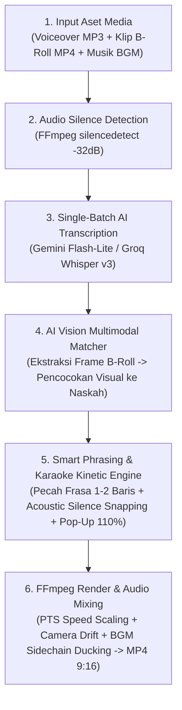

# 🎬 DOKUMEN MEKANISME & PANDUAN AI VIDEO SHOWCASE: AUTOSYNC VIDEO

> **Tujuan Dokumen Ini:**  
> Dokumen ini dirancang sebagai *context prompt* dan panduan teknis lengkap bagi AI (AI Video Generator, AI Scriptwriter, atau AI Storyboarder) agar memahami **cara kerja, mekanisme internal, alur kerja (workflow), dan keunggulan visual/audio** dari proyek **AutoSync Video (Desktop Local Edition)** untuk kebutuhan pembuatan video *showcase* / demonstrasi produk.

---

## 1. Identitas & Masalah yang Diselesaikan

* **Nama Proyek:** AutoSync Video (Automated Video & Voiceover Synchronization Engine)
* **Format Output:** Video Pendek Vertikal **9:16 (1080x1920 piksel, 24/30/60 FPS, MP4 FastStart)** untuk TikTok, Instagram Reels, dan YouTube Shorts.
* **Masalah Utama Kreator Konten:**  
  Mengedit video pendek secara manual membutuhkan waktu berjam-jam untuk:
  1. Memotong jeda napas voiceover.
  2. Mencari dan mengurutkan klip video B-roll agar nyambung dengan kalimat narator.
  3. Menyesuaikan kecepatan klip video (*speed ramping / stretching*) agar pas dengan durasi kalimat.
  4. Membuat *subtitle* per frasa pendek yang menyala per kata (*karaoke style*) beserta judul kapsul (*pill badge*).
  5. Mengatur naik-turunnya volume musik latar (*audio ducking*) saat narator berbicara.
* **Solusi AutoSync Video:**  
  Mengotomatiskan seluruh 5 pekerjaan di atas **hanya dalam hitungan detik** di komputer lokal menggunakan kombinasi **FFmpeg DSP Pipeline + Multimodal AI (Gemini Vision & Whisper STT) + Pillow Kinetic Typography Engine**.

---

## 2. Mekanisme Kerja Internal (6 Tahap Orkestrasi Mesin)

Berikut adalah urutan mekanisme teknis yang berjalan di balik layar dari awal hingga video selesai dirender:

### Tahap 1: Ingest & Pengelompokan Aset Media
Pengguna cukup melakukan *drag & drop* 3 jenis aset ke antarmuka web:
1. **1 File Rekaman Suara (Voiceover):** Narasi utuh dari awal sampai akhir (misal hasil ElevenLabs atau rekaman mikrofon).
2. **Kumpulan Klip Video Mentah (B-Roll):** Beberapa potongan video vertikal/horizontal berdurasi bebas.
3. **1 File Musik Latar (BGM - Opsional):** Lagu instrumen pendamping.

### Tahap 2: Deteksi Jeda Napas & Segmentasi Adegan Otomatis (*Audio Alignment*)
* Mesin memindai gelombang suara voiceover menggunakan filter FFmpeg `silencedetect=noise=-32dB:d=0.20`.
* Sistem mencari titik tengah (*midpoint*) dari jeda napas alami narator untuk membagi rekaman suara menjadi $N$ segmen adegan (sesuai jumlah klip video yang diunggah).
* Hasilnya: Setiap adegan mendapatkan cap waktu **`Mulai VO (start_time)`**, **`Selesai VO (end_time)`**, dan **`Durasi Target (target_duration)`** tanpa memotong kata yang sedang diucapkan.

### Tahap 3: Transkripsi Suara Satu-Batch & Pembuatan Lencana Judul (*AI Audio Transcriber*)
* Seluruh file audio dikirim dalam **1 panggilan API tunggal (*Single-Batch Request*)** ke model **Gemini 3.1 Flash-Lite** atau **Groq Whisper Large-v3-Turbo** (dengan `timestamp_granularities=["word", "segment"]`).
* Mesin secara otomatis menghasilkan:
  1. **Teks Naskah Akurat** untuk masing-masing rentang waktu adegan.
  2. **Lencana Judul (*CapCut Pill Badge*)** singkat (2–4 kata) yang merangkum inti adegan.
  3. **Cap Waktu Per Kata (*Word-Level Timestamps*)** dalam satuan milidetik.

### Tahap 4: Pencocokan Klip Video Berbasis AI Vision (*Multimodal Vision Matcher*)
* Agar urutan video tidak tertukar atau acak, mesin mengekstrak **1 frame gambar JPEG terkompresi (640px)** dari titik tengah setiap klip video B-roll.
* Seluruh frame gambar beserta daftar kalimat naskah dikirim ke **Gemini Vision**.
* AI menganalisis isi visual setiap gambar (misal: gambar HP, lorong server, grafik data, perisai keamanan) dan **memasangkan setiap klip video ke nomor adegan yang naskahnya paling relevan**.

### Tahap 5: Pemecahan Frasa Cerdas & Takarir Karaoke (*Kinetic Subtitle Generator*)
* **Smart Natural Phrasing:** Naskah panjang tidak ditampilkan menumpuk sekaligus. Mesin memecah kalimat berdasarkan tanda koma (`,`), titik (`.`), dan klausa menjadi **frasa pendek 1–2 baris (maksimal 8–10 kata per tampilan)** agar mata penonton nyaman membaca sambil menonton visual.
* **Acoustic Silence Snapping & Prosody Weighting:** Jeda kata pada koma dan titik dikunci (*snapped*) tepat ke celah hening napas narator di gelombang audio, serta dihitung bobot suku katanya (vokal Bahasa Indonesia & singkatan).
* **Kinetic Pop-Up Highlight:** Setiap frame kata dirender menggunakan *Pillow Graphics Engine* (1080x560 RGBA):
  * Di bagian atas: **Kapsul Lencana Judul (*Neon Pill Badge*)** dengan efek pendaran cahaya (*Gaussian Blur Glow*).
  * Di bagian bawah: **Kotak Takarir Gelap Pekat (97% Solid Dark Navy)** dengan teks putih murni ber-outline hitam 8-arah.
  * Kata yang sedang diucapkan narator **menyala dengan warna aksen neon, membesar +10% (44px ExtraBold), terangkat 3px ke atas, dan dikelilingi kapsul bercahaya**.

### Tahap 6: Transformasi Video, Gerak Kamera & *Smart Audio Ducking* (FFmpeg Pipeline)
* **PTS Speed Scaling (`setpts`):** Jika klip video mentah berdurasi `7.9 detik` sedangkan narator bicara selama `10.1 detik`, FFmpeg otomatis menyesuaikan kecepatan pemutaran video (`PTS = 1.28x`) agar panjang video 100% sama dengan suara narator tanpa patah-patah.
* **Dynamic Camera Motion (*Sinematik Drift*):** Klip video diperbesar sedikit (*overscan* `1156x2056`) dan digeser perlahan secara sinematik menggunakan rumus trigonometri `crop` FFmpeg sehingga video statis pun tampak hidup.
* **Clean Cut & Anti-Fade Subtitle:** Pergantian antar adegan berlangsung bersih (*Clean Cut*), dan lapisan teks ditempel di atas *base video* sehingga kalimat *punchline* di akhir adegan tidak pernah memudar/gelap.
* **BGM Sidechain Auto-Ducking:** Musik latar dipotong menyambung lintas adegan (`atrim=vo_start:vo_end`) dan diproses dengan filter `sidechaincompress`—volume musik otomatis merunduk halus saat suara narator masuk, dan kembali naik saat narator jeda bernapas.

---

## 3. Struktur Storyboard & Prompt untuk AI Pembuat Video Showcase

Jika Anda menugaskan AI untuk membuat video promosi/showcase berdurasi **45–50 detik (6 Adegan)** tentang proyek **AutoSync Video**, gunakan struktur storyboard dan *visual prompt* berikut:

### Adegan 1: Masalah Editing Manual (00:00 – 00:08)
* **Narasi Voiceover:** *"Pernah bayangin, bikin video pendek sekeren ini, tanpa harus edit manual berjam-jam?"*
* **On-Screen Pill Badge:** `Tanpa Edit Manual` (Warna Aksen: Merah Rose `#F43F5E`)
* **On-Screen Karaoke Text:** `Pernah bayangin, bikin video pendek sekeren ini, / tanpa harus [edit manual] berjam-jam?`
* **Prompt Visual untuk AI Video Generator (EN):**  
  > *Vertical 9:16 cinematic shot, a tired content creator late at night staring at a complex video editing timeline on a laptop screen in a dark modern room, blue and red neon reflections on face, shallow depth of field, 4k photorealistic.*

### Adegan 2: Memperkenalkan AutoSync Video (00:08 – 00:16)
* **Narasi Voiceover:** *"Kenalin, AutoSync Video. Kamu cukup masukkan rekaman suara, dan kumpulan klip video mentah."*
* **On-Screen Pill Badge:** `AutoSync Video` (Warna Aksen: Cyan Neon `#38BDF8`)
* **On-Screen Karaoke Text:** `Kenalin, [AutoSync Video]. / Kamu cukup masukkan rekaman suara, dan kumpulan klip video mentah.`
* **Prompt Visual untuk AI Video Generator (EN):**  
  > *Vertical 9:16 sleek futuristic dark UI dashboard floating in 3D space, glowing cyan audio waveform and video clip thumbnails smoothly snapping into place, clean modern tech aesthetic, 4k.*

### Adegan 3: Kecerdasan AI Vision Matcher (00:16 – 00:25)
* **Narasi Voiceover:** *"Mesin AI Vision otomatis menganalisis isi gambar, lalu mencocokkannya dengan kalimat yang sedang diucapkan."*
* **On-Screen Pill Badge:** `AI Vision Match` (Warna Aksen: Ungu Neon `#C084FC`)
* **On-Screen Karaoke Text:** `Mesin [AI Vision] otomatis menganalisis isi gambar, / lalu mencocokkannya dengan kalimat yang sedang diucapkan.`
* **Prompt Visual untuk AI Video Generator (EN):**  
  > *Vertical 9:16 futuristic AI neural network scanning multiple video frames, purple and cyan glowing bounding boxes connecting visual objects to script text cards, high-tech data visualization, 4k.*

### Adegan 4: Sinkronisasi Jeda Napas & Kecepatan Video (00:25 – 00:33)
* **Narasi Voiceover:** *"Bahkan, jeda napas dan kecepatan video diatur presisi mengikuti irama suaramu."*
* **On-Screen Pill Badge:** `Sinkronisasi Presisi` (Warna Aksen: Kuning Emas `#FACC15`)
* **On-Screen Karaoke Text:** `Bahkan, [jeda napas] dan kecepatan video / diatur presisi mengikuti irama suaramu.`
* **Prompt Visual untuk AI Video Generator (EN):**  
  > *Vertical 9:16 macro close-up of a glowing golden soundwave pulsing in sync with a digital clock and film strip frames aligning perfectly on a dark glass surface, cinematic lighting, 4k.*

### Adegan 5: Takarir Karaoke Pop-Up & Auto-Ducking BGM (00:33 – 00:41)
* **Narasi Voiceover:** *"Ditambah takarir dinamis yang menyala per kata, lengkap dengan musik latar otomatis."*
* **On-Screen Pill Badge:** `Karaoke Per Kata` (Warna Aksen: Hijau Emerald `#4ADE80`)
* **On-Screen Karaoke Text:** `Ditambah [takarir dinamis] yang menyala per kata, / lengkap dengan musik latar otomatis.`
* **Prompt Visual untuk AI Video Generator (EN):**  
  > *Vertical 9:16 close-up of a smartphone screen held in hand, displaying vibrant vertical video with glowing neon pill badge and kinetic karaoke subtitles popping up word by word, bokeh city lights background, 4k.*

### Adegan 6: Hasil Akhir Instan Siap Tayang (00:41 – 00:48)
* **Narasi Voiceover:** *"Sekali klik, video vertikal siap tayang dalam hitungan detik."*
* **On-Screen Pill Badge:** `Siap Tayang Cepat` (Warna Aksen: Oranye `#FB923C`)
* **On-Screen Karaoke Text:** `Sekali klik, video vertikal [siap tayang] dalam hitungan detik.`
* **Prompt Visual untuk AI Video Generator (EN):**  
  > *Vertical 9:16 confident young creator smiling at camera in a sunlit modern studio, pressing a glowing play button hologram, high energy, crisp commercial lighting, 4k.*

---

## 4. Ringkasan Spesifikasi Teknis (Untuk Ditampilkan di Layar / Infografis Video)

* **Frontend:** Next.js 16 (React, Tailwind CSS, Real-Time 9:16 Live Subtitle Simulator, Drag & Drop Slot Editor)
* **Backend:** FastAPI (Python 3.11, SQLAlchemy SQLite, Background Thread Worker)
* **AI Models:** Google Gemini 3.1 Flash-Lite / Gemini 3.5 Flash Vision + Groq Whisper Large-v3-Turbo (`word` & `segment` timestamps)
* **Media Processing:** FFmpeg Complex Filtergraph (`silencedetect`, `setpts`, dynamic `crop` camera motion, `sidechaincompress` BGM auto-ducking, `concat` demuxer) & Pillow RGBA Kinetic Typography
